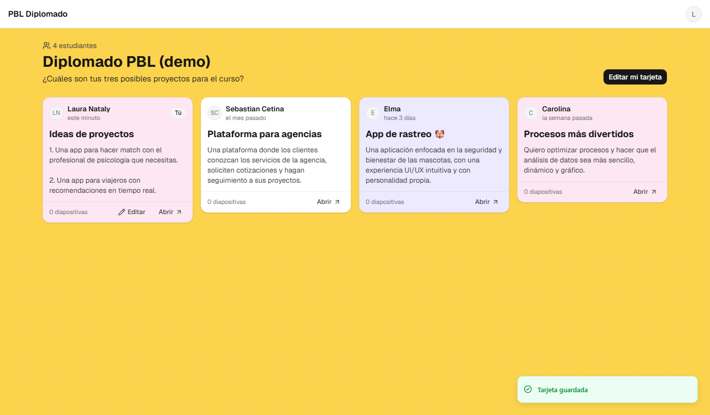

# Loop 02: M3 (the Padlet-like dashboard)

**Date:** 2026-10-26 · **Commits:** `ceed698` → `5d1c380` → `99fba66` (+ this report) · **Status:** ✅ code done, waiting for your deploy + acceptance test

---

## 1. Summary

- Each board now looks like the Padlet reference: a **yellow dotted background** with **one card per student**, showing avatar, name, "hace 3 días", project title, summary and card color.
- Cards update **live**: when a student saves their card, the teacher's screen changes without a reload.
- Students see **their own card first** (with a "Tú" badge) and can edit only their own card, from either of their accounts.
- Tested locally: **20 unit, 37 rules and 16 browser tests**.



## 2. Done

| Area                | What                                                                                                                                                                                                                                                                                               | Commit    |
| ------------------- | -------------------------------------------------------------------------------------------------------------------------------------------------------------------------------------------------------------------------------------------------------------------------------------------------- | --------- |
| Rules               | A student edits **only their own card** (title, summary, color), from any of their linked accounts, **only while the board is active**. The "updated at" time must be the server's, so nobody can fake "just updated". The teacher can only sync the name. Merging may create a card with content. | `ceed698` |
| Model               | 7 named card colors (white, yellow, pink, lilac, blue, green, orange), card profile validation                                                                                                                                                                                                     | `ceed698` |
| Dashboard           | Board header (title, description, student count), masonry columns (1 → 4 by screen width), live cards, my card first, skeletons while loading, empty and closed-board states, soft entrance animation (off when "reduce motion" is on)                                                             | `5d1c380` |
| Card                | Avatar (Google photo or initials), name, relative time, title, summary (line breaks kept), slide count, Edit (owner) and Open                                                                                                                                                                      | `5d1c380` |
| "Mi tarjeta" dialog | Title (120), summary (1000, with counter), color swatches with names (accessible)                                                                                                                                                                                                                  | `5d1c380` |
| Space page          | `/b/:boardId/s/:studentId`: the full card plus a placeholder for the slides (M5)                                                                                                                                                                                                                   | `5d1c380` |
| Rename sync         | When the teacher renames a student, their card's name updates too                                                                                                                                                                                                                                  | `5d1c380` |
| Demo + tests        | Seed with 3 example cards (like your Padlet), 6 new e2e flows, "hace un momento" for recent changes                                                                                                                                                                                                | `99fba66` |

## 3. Quality gate (`npm run check`)

| Check                               | Result                                                    |
| ----------------------------------- | --------------------------------------------------------- |
| Typecheck · lint · Prettier         | ✅ clean                                                  |
| Unit tests                          | ✅ **20 passed** (+7: relative time es/en, card ordering) |
| Rules tests (Firestore emulator)    | ✅ **37 passed** (+8: card editing)                       |
| End-to-end (Playwright + emulators) | ✅ **16 passed** (+6)                                     |
| Build                               | ✅ 1.51 MB JS (477 KB gzip), about the same as Loop 1     |

New e2e flows:

- the teacher sees the cards with their times and no Edit button;
- a student joins, finds their card first marked "Tú", and edits title, summary and color;
- a student can't edit a classmate's card;
- **live update**: the teacher's window shows a student's change without reloading, with the student using their _university_ account;
- the space page;
- renaming a student updates their card.

I also **looked at the result** (desktop and mobile screenshots) and fixed the one thing that read badly: "este minuto" became **"hace un momento"**.

## 4. Your turn

```bash
npm install
npm run deploy:rules
```

This deploys the rules for card editing (`Deploy complete!`). The indexes didn't change.

To try it with the demo board on your computer (no production data):

```bash
npm run emulators          # terminal 1
npm run seed               # terminal 2
npm run dev:emulators      # terminal 2 → http://localhost:5173
```

Then sign in as `laura@gmail.com` (student) or `docente@demo.edu` (teacher).

## 5. Acceptance test

With real accounts (`npm run dev`, after the deploy):

**As student (a second Google account of yours, added to a board in Loop 1)**

- [ ] Open the board: your card is **first** with **"Tú"**, and it says "Toca Editar para contar de qué trata tu proyecto"
- [ ] **Editar mi tarjeta** → title, summary, choose **Rosa** → **Guardar**. The card turns pink and says "hace un momento"
- [ ] Other students' cards (if any) have **no Edit** button

**As teacher (in another browser or a private window)**

- [ ] Open the same board **before** the student saves; after the save, the card changes **without reloading**
- [ ] The header shows "N estudiantes"; **Administrar** takes you to the students page
- [ ] Rename the student in **Administrar**, then go back to the board: the card shows the new name

**Mobile**

- [ ] Open the board on your phone (or a narrow window): one column, everything readable

## 6. Assumptions (decisions I took; tell me to change any)

| #   | Decision                                                                                                    | Why                                                                                      |
| --- | ----------------------------------------------------------------------------------------------------------- | ---------------------------------------------------------------------------------------- |
| A1  | **"Present" isn't on the cards yet**; it arrives with presentation mode (M6)                                | A button that leads nowhere is worse than no button                                      |
| A2  | Card order: **my card first**, then **by join date** (like Padlet)                                          | Stable order; a student's card doesn't jump around when they edit                        |
| A3  | Only students who **have signed in** have a card; invited-but-not-joined students don't appear on the board | Their space is created on first login; the teacher sees everyone in Administrar          |
| A4  | Students **can't change the name** on their card; only the teacher can (via the student list)               | Avoids nicknames or impersonation on a shared board                                      |
| A5  | The teacher **doesn't edit** students' cards                                                                | The card is the student's own voice; teacher feedback can come later (comments, M-later) |
| A6  | "Updated X ago" changes only when the **card** is edited, not on slide saves (M5)                           | Saves the free-tier reads (plan review R2)                                               |

## 7. Issues and risks

| #   | Issue                                                                                      | Status / impact                                                                        |
| --- | ------------------------------------------------------------------------------------------ | -------------------------------------------------------------------------------------- |
| I1  | The emulator cleanup script failed when **no** emulator was running (PowerShell exit code) | ✅ Fixed in `ceed698`                                                                  |
| I2  | Bundle size unchanged at 477 KB gzip                                                       | 🟡 Code-splitting is planned with M5 (Excalidraw)                                      |
| I3  | Reads: each open dashboard reads every card once, plus 1 read per card change              | 🟢 40 students × 40 open dashboards ≈ 1,600 reads per full refresh, well under 50K/day |

## 8. Next loop

**Loop 3 (M4): image uploads through the Cloudflare Worker** (Worker Steps 7–12)

- Worker: verify the Firebase login token, check permissions through Firestore (the rules decide), sign Cloudinary uploads
- App: prepare the image (resize/compress), signed upload with a progress bar, image registry (`assets`)
- **Card cover image** (the first use of uploads), shown on the dashboard as a small Cloudinary thumbnail
- Rules for `assets` and the cover, plus tests (Cloudinary mocked in the Worker tests)

**Before Loop 3 I need:** your deploy and the acceptance test. At the end of Loop 3 you'll run `npx wrangler deploy` and upload one real image.
