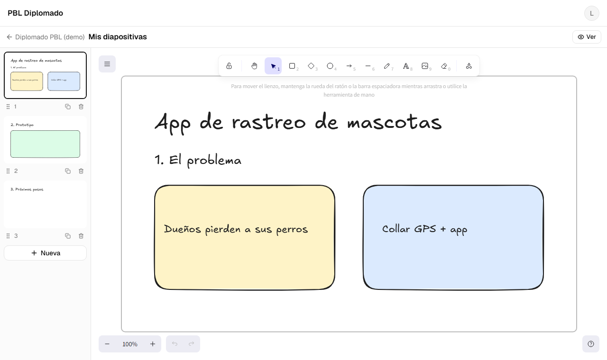

# Loop 04: M5 (slides with Excalidraw)

**Date:** 2026-10-27 · **Commits:** `c400ed6` → `12b8e3e` → `53c633d` (+ this report) · **Status:** ✅ code done, waiting for your deploys

---

## 1. Summary

- Each student now has a **slide editor** in their space. Every slide is an Excalidraw canvas with a fixed 16:9 area, and students can write text, draw, add shapes, links, images and YouTube/Vimeo/Figma/Google Slides videos.
- Slides **save by themselves** a few seconds after the student stops editing. The header shows "Guardando… / Guardado", or a clear message if a save fails.
- **Images in slides** use the same signed upload as the card cover. Only the reference is stored, never the image data.
- **Classmates and the teacher** see the slides read-only on the space page, and the card shows how many slides there are.
- Excalidraw loads only on the editor and slide pages. **The dashboard stays as light as before** (481 KB gzip).



## 2. Done

| Area             | What                                                                                                                                                                                                                         | Commit    |
| ---------------- | ---------------------------------------------------------------------------------------------------------------------------------------------------------------------------------------------------------------------------- | --------- |
| Rules + model    | `slides/{id}`: only the owner writes, only while the board is active. A new slide must be in the space's slide order (same batch). Shape and size are checked (≤ 900 KB, ≤ 30 images, ≤ 50 slides). Big fields have no index | `c400ed6` |
| Data + engine    | Add, duplicate, delete, reorder and save. Autosave: 3 s idle, at most one save every 15 s, also on slide switch, hidden tab and leaving. Embed allow-list + sandboxed iframes. Fonts served by the app (no CDN)              | `c400ed6` |
| Students         | Removing or merging students also deletes their slides                                                                                                                                                                       | `c400ed6` |
| Editor           | Slide sidebar (thumbnails, drag **or keyboard** to reorder, duplicate, delete with confirmation), save status, "slide almost full" warning, fits on phones                                                                   | `12b8e3e` |
| Images in slides | Dropped, pasted or inserted images are resized in the browser, signed by the Worker, uploaded to Cloudinary and registered (`kind: 'slide'`). Failed uploads are removed from the slide with a message                       | `12b8e3e` |
| Viewer           | The space page lists the slides, rendered as crisp SVG with the hand-drawn fonts and live (sandboxed) videos. "Editar diapositivas" is shown only to the owner of an active board                                            | `12b8e3e` |
| Card date        | Saving slides refreshes "updated …" on the card at most every 10 minutes (protects the 50K reads/day)                                                                                                                        | `12b8e3e` |
| Tests            | 6 new e2e flows; shared network fakes for the Worker and Cloudinary                                                                                                                                                          | `53c633d` |

Fixes from the plan review before this loop: a misplaced code comment, saves rejected late now show an error instead of "Guardado", the embed allow-list and sandbox, and a rules guard on `assetIds`.

## 3. Quality gate

| Check                               | Result                                                       |
| ----------------------------------- | ------------------------------------------------------------ |
| Typecheck · lint · Prettier         | ✅ clean                                                     |
| Unit tests                          | ✅ **41 passed** (+14 since Loop 3: autosave, scene, embeds) |
| Worker tests (offline)              | ✅ **19 passed**                                             |
| Rules tests (Firestore emulator)    | ✅ **49 passed** (+7: slides)                                |
| End-to-end (Playwright + emulators) | ✅ **27 passed** (+6)                                        |
| Worker integration (real Worker)    | ✅ **6/6**                                                   |
| Build                               | ✅ main bundle 1.52 MB JS (**481 KB gzip**, same as Loop 3)  |

Excalidraw is in separate chunks that load only when needed: about 1.1 MB gzip for the editor, and less for the viewer. Its diagram tools (Mermaid) are further chunks that load only if a student uses them. With the self-hosted fonts, `dist/` is now 23 MB, well inside Hosting's 10 GB.

New e2e flows:

- a student creates a slide, writes text, it saves by itself and is still there after reloading;
- adding, duplicating, deleting and reordering slides with the keyboard; switching slides saves the current one;
- a dropped image is signed, uploaded, stored as a Cloudinary reference and registered;
- a classmate and the teacher see the slides read-only; opening someone else's editor goes back to the viewer;
- only allow-listed videos play, always sandboxed (a non-allow-listed site is removed);
- locking the board sends the owner from the editor to the read-only view.

## 4. Your turn

All four milestones' rules are still waiting to be deployed. **The current production rules expire on 2026-11-25.**

```bash
npm install                # new: Excalidraw, dnd-kit
npm run deploy:rules       # rules + indexes for M2–M5 (one deploy covers all)
npm run worker:deploy      # Worker from Loop 3 (signing), if not done yet
```

Then try it on your computer: `npm run dev`, sign in as a student, open your card → **Editar diapositivas**.

## 5. Acceptance test

**As student (your second Google account, a member of an active board)**

- [ ] Open your space → **Editar diapositivas** → **Crear la primera diapositiva**
- [ ] Write a title with the text tool, draw a rectangle, change colors. After a few seconds the header says **Guardado**
- [ ] Drag a photo from your computer onto the slide (or paste one). It appears, and after saving it's in Cloudinary under `pbl/dev/<board>/<student>/`
- [ ] Paste a YouTube link with the embed tool (the "more tools" icon at the end of the toolbar). The video plays on the slide
- [ ] **Nueva**, **Duplicar**, drag a slide to another position, **Eliminar** one (it asks first)
- [ ] Reload the page: everything is still there, in the same order
- [ ] On your phone: the editor works and the slide fits the screen

**As teacher (another browser or a private window)**

- [ ] The student's card shows "N diapositivas". Open it: the slides look like the editor, and the video plays
- [ ] There is no "Editar diapositivas" button for you

**As another student (optional)**

- [ ] You can see your classmate's slides, but not edit them

## 6. Assumptions (decisions I took; tell me to change any)

| #   | Decision                                                                                                                             | Why                                                                                                                           |
| --- | ------------------------------------------------------------------------------------------------------------------------------------ | ----------------------------------------------------------------------------------------------------------------------------- |
| A1  | The slide area is **960 × 540** instead of the 1920 × 1080 in the plan                                                               | At 1920 × 1080, Excalidraw's biggest font looks small on a projector. The slide is exported as SVG, so it's sharp at any size |
| A2  | Videos allowed live on slides: **YouTube, Vimeo, Figma, Google Docs/Slides, Canva**. Other links stay as normal links                | Classmates' slides run on everyone's screen; an allow-list plus sandbox avoids phishing frames                                |
| A3  | No first slide is created automatically. The student taps **Crear la primera diapositiva**                                           | No empty slides (or writes) for students who never use the editor                                                             |
| A4  | If the same student edits one slide in two tabs at once, **the last save wins**                                                      | Real-time co-editing needs a paid backend or much more quota; one student per space makes it rare                             |
| A5  | The space page shows **all slides one under another**. Full-screen presenting is M6                                                  | Simple and works on phones; M6 adds the presenter                                                                             |
| A6  | Deleting a slide doesn't touch its images right away. The M7 cleanup finds unused images (registry minus what slides and covers use) | One cleanup path, as with covers (Loop 3, A3)                                                                                 |
| A7  | Excalidraw's shape **library** and **AI** tools are hidden. The Mermaid diagram tool stays (free, runs in the browser)               | "Basic edition" from the plan; the library needs an external site                                                             |

## 7. Issues and risks

| #   | Issue                                                                                                                                                                                                                                                                                                                                       | Status / impact                                                                                                    |
| --- | ------------------------------------------------------------------------------------------------------------------------------------------------------------------------------------------------------------------------------------------------------------------------------------------------------------------------------------------- | ------------------------------------------------------------------------------------------------------------------ |
| I1  | **The Firestore emulator sometimes stops in the middle of a test run** on this computer (Windows exit code `0xC000013A`, which is a console "Ctrl+C"). It happened with `emulators:exec` and with the emulators started separately, during different tests, with no log or crash file. When it happens, every test after it fails in ~20 ms | 🟡 Local test tooling only, not the app. The gate passed on a clean run. If you see it, just run the command again |
| I2  | The rules can't check each image reference inside a slide one by one (Firestore rules have no loops), unlike the cover                                                                                                                                                                                                                      | 🟢 Only the count is checked; M7 cleanup will only trust the registry (folder + student) before deleting           |
| I3  | Excalidraw adds ~1.1 MB gzip, loaded only on the editor / slide pages                                                                                                                                                                                                                                                                       | 🟢 Cached by the browser; ~44 MB for a class of 40 on first visit, well under Hosting's 360 MB/day                 |
| I4  | A slide edited while offline is saved in the browser and sent when the connection returns. Closing the tab with unsaved changes asks for confirmation                                                                                                                                                                                       | 🟢 As designed                                                                                                     |
| I5  | Free tier: a class of 40 editing at once → at most ~4 writes/min per student (≈ 5K writes in a 30-min class)                                                                                                                                                                                                                                | 🟢 Under the 20K/day limit, as planned in review R1                                                                |

## 8. Next loop

**Loop 5 (M6): presentation mode**

- Full screen, ←/→ for slides, ↑/↓ for the next/previous student, Esc to exit, student picker and overview
- The next slide is preloaded, with GSAP transitions (off when the user prefers reduced motion)
- "Presentar" on the cards for the teacher (moved here from M3)

**Before Loop 5 I need:** `npm run deploy:rules` (+ `npm run worker:deploy` if not done) and the acceptance test above.
