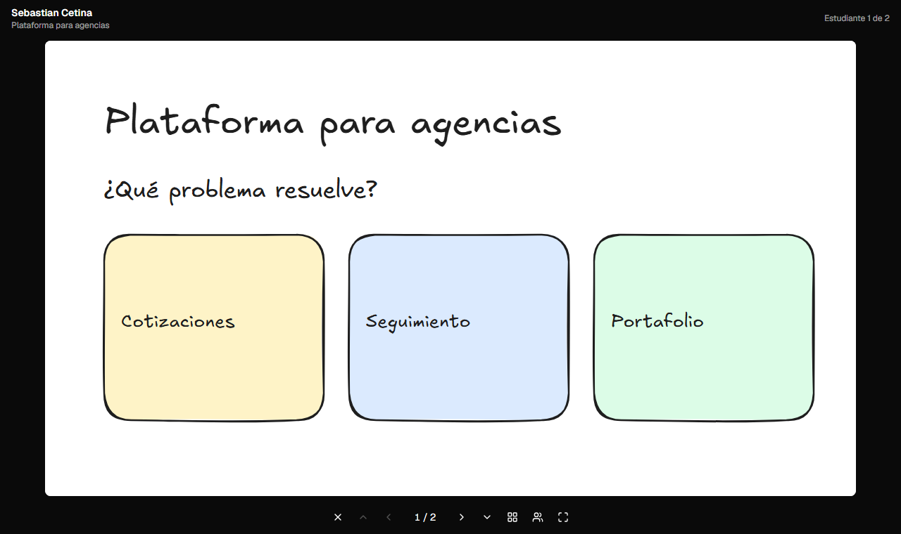

# Loop 05: M6 (presentation mode)

**Date:** 2026-10-27 · **Commits:** `3b45a40` → `e81ca6a` (+ this report) · **Status:** ✅ code done, no new deploy needed beyond Loop 4's

---

## 1. Summary

- The teacher can **present the whole board**: one slide fills the screen, **←/→** move through a student's slides and continue to the next student, **↑/↓** jump between students. Students without slides are skipped.
- **"Presentar"** appears on each card with slides (teacher), as **"Presentar tablero"** in the board header, and on the space page (teacher or the owner).
- **Students present only their own space**, for example to show their progress in class.
- Full screen (**F**), overview of all slides (**O**), a student picker, touch swipes and presentation clickers (PageUp/PageDown) all work. Controls fade out while the mouse is still.
- Slide changes are animated with GSAP, with no animation for users who ask for reduced motion. The next slides and the next student are **prepared in advance**, so changing slides is instant.



## 2. Done

| Area          | What                                                                                                                                                     | Commit    |
| ------------- | -------------------------------------------------------------------------------------------------------------------------------------------------------- | --------- |
| Navigation    | Pure, unit-tested rules for moving between slides and students (edges, "last slide of the previous student", students without slides) and key mapping    | `3b45a40` |
| Presenter     | `/b/:board/present/:student?`, full screen without the app header. Header shows the student and project, plus "Estudiante 2 de 12" for the teacher       | `3b45a40` |
| Controls      | Exit, ↑ ← counter → ↓, overview, student picker, full screen. Keyboard, clicker and touch swipe. Auto-hide after 2.5 s                                   | `3b45a40` |
| Quality       | Slides use 1920 px images when presenting (1280 px elsewhere). Neighbouring slides and the next student are preloaded                                    | `3b45a40` |
| Who sees what | Teacher: every student with slides. Student: only their own space; opening someone else's presentation shows the read-only viewer instead                | `3b45a40` |
| Entry points  | "Presentar" on cards with slides (teacher), "Presentar tablero" (teacher, when someone has slides), and "Presentar" on the space page (teacher or owner) | `3b45a40` |
| Tests         | 6 unit tests (navigation), 4 e2e flows, shared slide fixtures                                                                                            | `e81ca6a` |

## 3. Quality gate

| Check                               | Result                                                   |
| ----------------------------------- | -------------------------------------------------------- |
| Typecheck · lint · Prettier         | ✅ clean                                                 |
| Unit tests                          | ✅ **47 passed** (+6)                                    |
| Worker tests (offline)              | ✅ **19 passed**                                         |
| Rules tests (Firestore emulator)    | ✅ **49 passed** (no rule changes needed)                |
| End-to-end (Playwright + emulators) | ✅ **31 passed** (+4)                                    |
| Worker integration (real Worker)    | ✅ **6/6**                                               |
| Build                               | ✅ main bundle **484 KB gzip** (+3 KB for the presenter) |

New e2e flows:

- the teacher presents the board with the keyboard: →, past the end to the next student, ← back to the previous student's last slide, ↓/↑, Esc back to the board;
- "Presentar" on one card, the overview (pick slide 2) and the student picker; no "Presentar" on cards without slides;
- a student presents their own slides, can't move to classmates, and opening a classmate's presentation shows the read-only viewer;
- buttons and a touch swipe move between slides; "Salir" goes back.

The Firestore emulator didn't stop mid-run this time (Loop 4, I1).

## 4. Your turn

Nothing new to deploy for M6: presenting only reads data the rules already allow. If Loop 4's deploys are still pending, they are the same commands. **The production rules expire on 2026-11-25.**

```bash
npm install
npm run deploy:rules       # M2–M5 rules + indexes
npm run worker:deploy      # if not done after Loop 3
```

## 5. Acceptance test

Best done in the classroom setup: laptop + projector, or a second screen.

**As teacher**

- [ ] Board → **Presentar tablero**: the first student with slides appears. **F** goes full screen
- [ ] **→** through the slides; after the last one it moves to the next student. **←** goes back
- [ ] **↓ / ↑** jump to the next / previous student. **O** shows all slides of the student; click one
- [ ] The people icon lists the students; pick one
- [ ] If you have a presentation clicker, it moves the slides
- [ ] A slide with a YouTube video plays inside the presentation
- [ ] **Esc** leaves full screen, and **Esc** again goes back to the board
- [ ] On a card: **Presentar** opens that student's slides directly

**As student**

- [ ] Your space page → **Presentar**: only your slides; ↑/↓ do nothing
- [ ] On a phone, turned sideways: the slide fills the screen, and swiping left/right changes slides

## 6. Assumptions (decisions I took; tell me to change any)

| #   | Decision                                                                                                                        | Why                                                                              |
| --- | ------------------------------------------------------------------------------------------------------------------------------- | -------------------------------------------------------------------------------- |
| A1  | **→ after a student's last slide continues with the next student** (and ← from the first slide goes to the previous one's last) | A class presentation flows with one key (or a clicker that only has two buttons) |
| A2  | **Students with no slides are skipped** in the teacher's presentation                                                           | No empty screens in front of the class; their card has no "Presentar" either     |
| A3  | Order = the board order (who joined first), not "my card first"                                                                 | The same order every time, and the same order as the cards for the teacher       |
| A4  | **Students can present only their own space** (classmates' spaces are still visible read-only on the space page)                | As in the plan (F5); the teacher drives the class presentation                   |
| A5  | Full screen starts with **F** or the button, not automatically                                                                  | Browsers allow full screen only after a click or key press                       |
| A6  | No slide number in the URL (only the student)                                                                                   | Reloading starts the student again from slide 1; simpler and enough for class    |

## 7. Issues and risks

| #   | Issue                                                                                                                             | Status / impact                                                                                  |
| --- | --------------------------------------------------------------------------------------------------------------------------------- | ------------------------------------------------------------------------------------------------ |
| I1  | iPhone Safari doesn't allow full screen for web pages                                                                             | 🟢 The button is hidden there; the presenter already fills the screen (on phones, turn sideways) |
| I2  | Keys don't reach the presenter while an embedded video has the focus (clicking inside a YouTube player)                           | 🟢 Browser security; click outside the video (or use the on-screen buttons) to continue          |
| I3  | Free tier: presenting a class of 40 with ~10 slides each reads ~450 slide documents plus the cards, about what the plan estimated | 🟢 Well under 50K reads/day; images come from Cloudinary's CDN at 1920 px (~200 KB each)         |
| I4  | Loop 4's I1 (the emulator sometimes stops mid-test on this computer) didn't happen this loop                                      | 🟡 Still open; re-run the command if it does                                                     |

## 8. Next loop

**Loop 6 (M7): data lifecycle and backups**

- "Proyectos archivados": boards move there after 90 days without use; archive now / restore
- Storage page: images used, **clean up unused images**, Cloudinary usage meter (Worker: delete, purge, usage)
- Board backup (JSON) and restore into a new board; purge (archived board + backup first)
- CLI: `cleanup`, `board archive | restore | purge`, `backup`, `usage`

**Before Loop 6 I need:** Loop 4's deploys done (`deploy:rules`, `worker:deploy`) and one real upload. Loop 6 adds new Worker routes that delete images from Cloudinary, so the Worker in production must be up to date.
