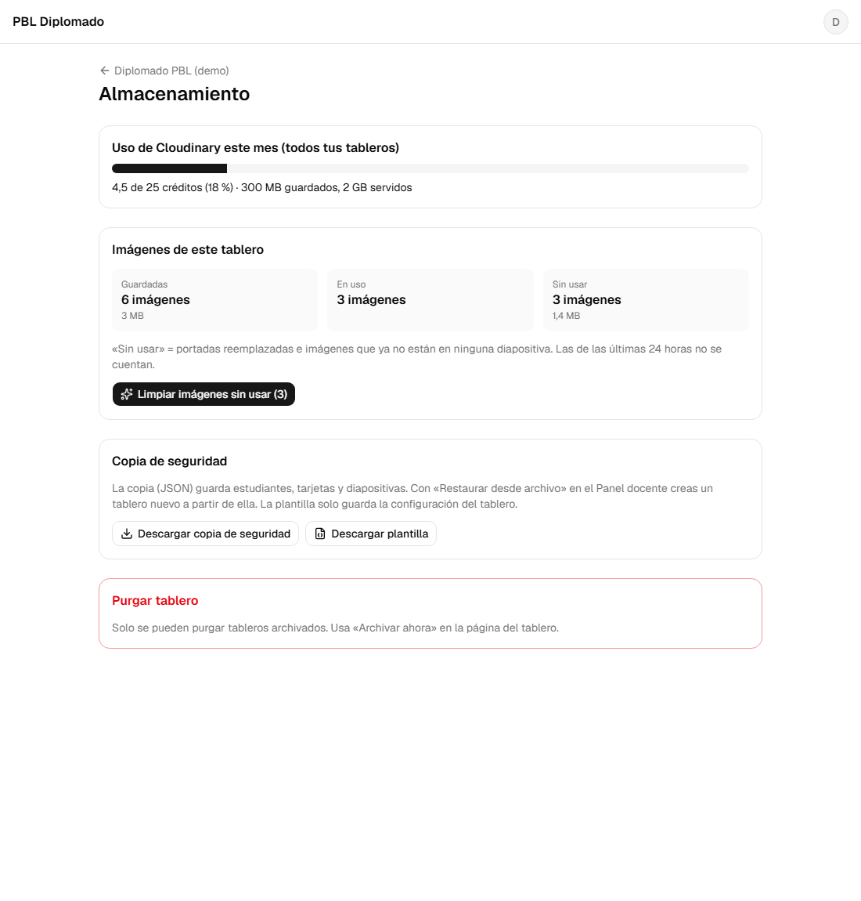

# Loop 06: M7 (data lifecycle and backups)

**Date:** 2026-10-27 · **Commits:** `0d72828` → `aaf5ec9` → `ef62e4d` → `a5706c4` (+ this report) · **Status:** ✅ code done, waiting for your deploys

---

## 1. Summary

- Boards nobody uses for **90 days** (configurable per board) move to **"Proyectos archivados"** by themselves, for the teacher and the students. Archived boards can be viewed and presented, but not edited. **"Archivar ahora"** and **"Restaurar"** are on the board page.
- A new **Almacenamiento** (storage) page per board shows:
  - Cloudinary credits used this month, with a warning at 70 %.
  - This board's images, and how many are unused.
  - **"Limpiar imágenes sin usar"**, which deletes the unused images from Cloudinary.
- Teachers can download a **backup** (JSON) or a **template** of a board, and create a new board from either with **"Restaurar desde archivo"**.
- **Purge** deletes an archived board for good: its images in Cloudinary and all its data. It only works after downloading the backup and typing the board name.
- The **admin CLI** can do the same from your computer: `board archive | restore | purge`, `backup`, `cleanup`, `usage`.



## 2. Done

| Area             | What                                                                                                                                                                                                                                                           | Commit               |
| ---------------- | -------------------------------------------------------------------------------------------------------------------------------------------------------------------------------------------------------------------------------------------------------------- | -------------------- |
| Lifecycle        | Auto-archive after N days without activity, with no scheduled job: the app compares dates when it lists boards, and the rules make the same check before any student write. Archive now, restore, 30–365 day setting, "Considera purgar" after a year archived | `0d72828`            |
| Activity         | Slide saves, card and cover edits and student-list edits record activity on the board, **at most once an hour** (protects the 20K writes/day)                                                                                                                  | `0d72828`            |
| Rules            | Writes need an active, not auto-archived board. Members may only update `lastActivityAt`. The teacher can delete an **archived** board and its image registry (purge). The teacher can create slides listed in a space (restore)                               | `0d72828`            |
| Worker           | `POST /assets/delete` (board teacher; only images already marked unused; 40 per call), `POST /boards/purge` (archived boards; prod + dev folders; resumable), `GET /usage` (teachers). Uploads are also refused on auto-archived boards                        | `aaf5ec9`            |
| Storage page     | Usage meter, this board's images (stored / in use / unused), cleanup with confirmation, backup and template downloads, purge in 3 steps                                                                                                                        | `aaf5ec9`            |
| Backup / restore | `pbl.boardBackup` and `pbl.boardTemplate` JSON files, validated before anything is written. Restore always creates a new board                                                                                                                                 | `aaf5ec9`            |
| CLI              | `board archive \| restore \| purge`, `backup`, `cleanup --board <id> \| --all [--dry-run]`, `usage`. It uses the same code as the app for lifecycle, unused images and backups. Purge writes a backup to `backups/` first                                      | `a5706c4`            |
| Tests            | 6 e2e flows; real-Worker integration grows from 6 to 16 checks (local fake Cloudinary); new `npm run test:admin` (real CLI + emulator + fake Cloudinary, 9 checks)                                                                                             | `ef62e4d`, `a5706c4` |

## 3. Quality gate (`npm run check`)

| Check                               | Result                                                                         |
| ----------------------------------- | ------------------------------------------------------------------------------ |
| Typecheck · lint · Prettier         | ✅ clean                                                                       |
| Unit tests                          | ✅ **62 passed** (+15: lifecycle, unused images, backup files)                 |
| Worker tests (offline)              | ✅ **27 passed** (+8: delete, purge, usage, Cloudinary client, auto-archive)   |
| Rules tests (Firestore emulator)    | ✅ **54 passed** (+5: activity, auto-archive, archive/restore, purge, restore) |
| End-to-end (Playwright + emulators) | ✅ **37 passed** (+6)                                                          |
| Worker integration (real Worker)    | ✅ **16/16** (+10)                                                             |
| Admin CLI integration (new)         | ✅ **9/9**                                                                     |
| Build                               | ✅ main bundle **495 KB gzip** (+11 KB: storage page and backup validation)    |

New e2e flows:

- the teacher archives a board → it appears under "Proyectos archivados" for teacher and student, read-only → restore;
- a board with no activity for 100 days is archived by itself; restore and change the limit to 180 days;
- a student's card edit records activity on the board;
- the storage page shows the credits meter (with the 70 % warning) and finds 2 unused images out of 5 (one from today is left alone); cleanup marks them "deleted";
- download a backup → restore it into a new board, with students, cards, slides and email index; a wrong file is refused;
- purge: refused while active; needs the backup downloaded and the exact name; afterwards every document and the invite code are gone.

## 4. Your turn

```bash
npm install
npm run deploy:rules       # M2–M7 rules + indexes (the old open rules expire 2026-11-25)
npm run worker:deploy      # new routes: delete, purge, usage
```

The Loop 3 Worker is already live: on 2026-10-27, `/me` answered 401 (it exists). This deploy adds the M7 routes.

**For the admin CLI only:** create `.env.admin.local` in the project root (it's git-ignored). Copy the values from Cloudinary → Settings → API Keys, the same key and secret the Worker uses:

```bash
CLOUDINARY_CLOUD_NAME=syqkgwws
CLOUDINARY_API_KEY=719523683767324
CLOUDINARY_API_SECRET=<your secret>
```

Then try it safely: `npm run admin -- usage` and `npm run admin -- cleanup --all --dry-run`. Both only read.

## 5. Acceptance test

**As teacher**

- [ ] Board page → **Ciclo de vida** shows "pasará a «Proyectos archivados» el …". Change the delay to 180 days
- [ ] **Almacenamiento**: the Cloudinary meter shows your real credits. "Imágenes de este tablero" counts the cover you uploaded in Loop 3
- [ ] Change a cover twice (as a student), wait 24 h (or use a test board), then **Limpiar imágenes sin usar**. The old covers disappear from the Cloudinary Media Library
- [ ] **Descargar copia de seguridad** → Panel docente → **Restaurar desde archivo** → a new board with the same students, cards and slides
- [ ] On that **restored test board**: **Archivar ahora** → it moves to "Proyectos archivados" → **Almacenamiento** → download the backup, type the name, **Purgar definitivamente**. The board is gone
- [ ] **Restaurar** on an archived board brings it back

**As student**

- [ ] An archived board appears under "Proyectos archivados". You can open it and present your slides, but "Editar mi tarjeta" is gone

**Admin CLI (optional)**

- [ ] `npm run admin -- usage`: credits and documents per board
- [ ] `npm run admin -- backup <boardId>`: a file appears in `backups/`

## 6. Assumptions (decisions I took; tell me to change any)

| #   | Decision                                                                                                                                                                            | Why                                                                                                               |
| --- | ----------------------------------------------------------------------------------------------------------------------------------------------------------------------------------- | ----------------------------------------------------------------------------------------------------------------- |
| A1  | **Activity** = any edit (slides, cards, covers, student list), recorded at most once an hour. Only viewing or presenting doesn't count                                              | As in the plan; viewing an old board shouldn't keep it "alive" forever                                            |
| A2  | An auto-archived board needs **"Restaurar"** by the teacher; students can't revive it by editing                                                                                    | Otherwise the archive would never hold; the rules enforce it                                                      |
| A3  | Purge needs **"Archivar ahora"** first (status `archived`), not just auto-archived                                                                                                  | An explicit, two-step decision before deleting anything for good                                                  |
| A4  | **Restore** brings back students (as "invited", they join again with their email), cards and slides. **Covers are not restored**; slide images keep their old Cloudinary references | The rules only accept covers uploaded to that board; slide images work as long as the original board isn't purged |
| A5  | The backup has **no image files**, only references (as in the plan). Purging the original board makes those images unavailable in a restored copy                                   | Keeps the backup small (KBs, not hundreds of MB); downloading every image would cost Cloudinary bandwidth         |
| A6  | Cleanup and purge also cover images uploaded while testing from `localhost` (`pbl/dev/<board>/`)                                                                                    | When developing against the real project, those images belong to real boards too                                  |
| A7  | The CLI purge asks you to **type the board title** (or `--yes` in scripts) and always writes the backup first                                                                       | Same safety as the dashboard                                                                                      |

## 7. Issues and risks

| #   | Issue                                                                                                                   | Status / impact                                                                                                          |
| --- | ----------------------------------------------------------------------------------------------------------------------- | ------------------------------------------------------------------------------------------------------------------------ |
| I1  | Cloudflare's free plan allows **50 outgoing requests per Worker call**                                                  | ✅ Handled: cleanup goes 40 images per call; purge stops after 5 Cloudinary calls (5,000 images) and the app calls again |
| I2  | Empty Cloudinary folders stay after a purge (the images are deleted)                                                    | 🟢 Empty folders cost nothing; delete them in the Media Library if you want a tidy view                                  |
| I3  | The storage page reads the whole board once (students, cards, slides, registry): ~a few hundred reads for a class of 40 | 🟢 On demand only, not live; well under 50K reads/day                                                                    |
| I4  | Main bundle +11 KB gzip                                                                                                 | 🟢 Could be split into a teacher-only chunk in M8 if needed                                                              |
| I5  | Loop 4's emulator stop (Windows, `0xC000013A`) didn't happen this loop                                                  | 🟡 Still open; re-run the command if it does                                                                             |
| I6  | `npm run check` now takes ~12 minutes (two integration tests)                                                           | 🟢 The individual scripts are faster for day-to-day work                                                                 |

## 8. Next loop

**Loop 7 (M8): hardening and launch**

- Full rules review
- **App Check** with reCAPTCHA v3 (free) on Firestore; the Worker accepts only the app's origins and valid tokens
- Privacy notice on the login page (Ley 1581 de 2012)
- Final `<title>`, `lang="es"`, favicon, Open Graph; Hosting deploy

**Before Loop 7 I need:**

1. The deploys above.
2. **A reCAPTCHA v3 site key.** In the Google reCAPTCHA admin console, create a v3 key for `diplomado-fc679.web.app`, `diplomado-fc679.firebaseapp.com` and `localhost`, then register it in Firebase console → App Check. I'll write the steps in detail at the start of the loop if you prefer.
