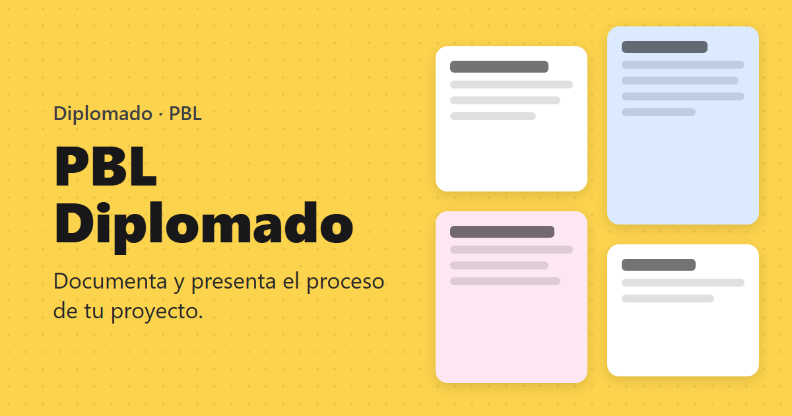

# Loop 07: M8 (hardening and launch)

**Date:** 2026-10-27 · **Commits:** `e423b86` → `c7bbbca` → `5443e90` (+ this report) · **Status:** ✅ code done, ready to launch: the steps in section 4 are yours

---

## 1. Summary

- **Full Security Rules review.** It found and fixed one **serious hole**: anyone could take over the space of a student who had joined with the invite link. Three smaller gaps are closed too. The current production rules are older and don't have this fix, so **deploying the rules is now urgent**.
- **App Check (reCAPTCHA v3, free)** is ready in the app and in the Worker. It stays off until you create the key, then runs in "monitor" mode (log only) until you decide to enforce it.
- **Privacy notice** under Colombia's Ley 1581 de 2012, at `/privacidad`. It's linked from the login page and from the footer of every page.
- **Launch details:**
  - The page is in Spanish (`lang="es"`), titled "PBL Diplomado", with a new favicon and a social preview image.
  - Search engines are told not to index it.
  - Hosting gets cache rules and basic security headers.
  - The teacher area is a separate download that students never load.



## 2. Done

### Security Rules review

| #   | Finding                                                                                                                                                                                                                                                                                              | Severity | Fix                                                                                                                                                                                      |
| --- | ---------------------------------------------------------------------------------------------------------------------------------------------------------------------------------------------------------------------------------------------------------------------------------------------------- | -------- | ---------------------------------------------------------------------------------------------------------------------------------------------------------------------------------------- |
| S1  | **Space takeover via the invite link.** The email index rule only checked that the target student came from an invite. So any signed-in user could point their own email and account at another invite-joined student, then edit that student's card and slides. They didn't even need the join code | 🔴 High  | The index entry must belong to a **new** student created in the same batch, whose only email and account are the caller's. A test reproduced the attack before the fix and now blocks it |
| S2  | The invite link still worked on auto-archived boards                                                                                                                                                                                                                                                 | 🟡 Low   | Same date check as every other write                                                                                                                                                     |
| S3  | `ownerPhotoURL` (shown to classmates) accepted any string, e.g. `javascript:` or tracking URLs                                                                                                                                                                                                       | 🟡 Low   | `https://` only, ≤ 2,000 chars                                                                                                                                                           |
| S4  | `users.displayName` / `photoURL` had no size or format limits                                                                                                                                                                                                                                        | 🟢 Info  | ≤ 200 chars; photo `https://` only                                                                                                                                                       |

Reviewed with no change needed: deny by default; teacher detection by email path (R6); board teachers only on their own boards; members read-only outside their own space; slides, assets and covers tied to the owner and to writable boards; purge only for archived boards; collection-group queries limited to the caller's own email and uid.

Accepted, as documented in Loop 4: rules can't loop over a slide's `files` map. The cleanup only trusts the asset registry, and the viewer sanitizes links and embeds.

### Commits

| Area      | What                                                                                                                                                                                                                                                                                                                                                                                   | Commit    |
| --------- | -------------------------------------------------------------------------------------------------------------------------------------------------------------------------------------------------------------------------------------------------------------------------------------------------------------------------------------------------------------------------------------- | --------- |
| Rules     | S1–S4 + 4 tests (58 rules tests)                                                                                                                                                                                                                                                                                                                                                       | `e423b86` |
| App Check | App: reCAPTCHA v3 provider when `VITE_RECAPTCHA_SITE_KEY` is set (never on the emulators; debug token on localhost); Worker requests carry `X-Firebase-AppCheck`. Worker: `APP_CHECK` = `off` / `monitor` / `enforce`; tokens checked against Firebase's keys for this project; **the token is forwarded to Firestore**, so the Worker keeps working once Firestore enforces App Check | `c7bbbca` |
| Privacy   | `/privacidad` in es/en: who is responsible, which data, what for, who sees it, where it's stored (incl. transfer outside Colombia), how long, rights (incl. SIC), reCAPTCHA notice. Optional `VITE_PRIVACY_CONTACT`                                                                                                                                                                    | `5443e90` |
| Launch    | `index.html` (es, title, description, theme color, Open Graph, `noindex`), favicon, apple-touch-icon, `robots.txt`, Hosting headers (1-year cache for hashed files, `no-cache` for `index.html`, `nosniff`, `Referrer-Policy`, `Permissions-Policy`), teacher chunk                                                                                                                    | `5443e90` |

## 3. Quality gate (`npm run check`)

| Check                               | Result                                                                                              |
| ----------------------------------- | --------------------------------------------------------------------------------------------------- |
| Typecheck · lint · Prettier         | ✅ clean                                                                                            |
| Unit tests                          | ✅ **62 passed**                                                                                    |
| Worker tests (offline)              | ✅ **31 passed** (+4: App Check modes, forwarding, CORS)                                            |
| Rules tests (Firestore emulator)    | ✅ **58 passed** (+4: review findings)                                                              |
| End-to-end (Playwright + emulators) | ✅ **40 passed** (+3: privacy notice, metadata, teacher chunk)                                      |
| Worker integration (real Worker)    | ✅ **16/16**                                                                                        |
| Admin CLI integration               | ✅ **9/9**                                                                                          |
| Build                               | ✅ first load **≈ 494 KB JS gzip** (about the same: App Check added ≈ what the teacher chunk saved) |

## 4. Your turn: launch, step by step

**Today (urgent, because of S1).** The current production rules expire on 2026-11-25.

```bash
npm install
npm run deploy:rules       # M2–M8 rules + indexes, including the S1 fix
npm run worker:deploy      # M7 routes (delete / purge / usage) + App Check in monitor mode
```

Check: `https://media-api.paradisserossa.workers.dev/usage` should answer **401**, not 404.

**reCAPTCHA v3 key (free, ~5 min):**

1. Open the reCAPTCHA admin console (search "reCAPTCHA admin console" → **v3 Admin Console**) and sign in with your Gmail.
2. **Create (+)**: label `PBL Diplomado`, type **Score based (v3)**, domains `diplomado-fc679.web.app`, `diplomado-fc679.firebaseapp.com`, `localhost` → Submit.
3. Copy the **site key** (public) and the **secret key** (private: it goes only into the Firebase console, never in a file or the chat).
4. Firebase console → **App Check** → **Apps** → your web app → **reCAPTCHA** → paste the **secret key** → Save.
5. In the project, add the **site key** to `.env.production` (and to `.env.local` if you develop against the real project):
   ```bash
   VITE_RECAPTCHA_SITE_KEY=<site key>
   ```
6. Local development against the real project: run `npm run dev` once. The browser console prints an **App Check debug token**. Register it in Firebase console → App Check → your app → ⋮ → **Manage debug tokens**, and put it in `.env.local` as `VITE_APPCHECK_DEBUG_TOKEN=…`.

**Optional:** add `VITE_PRIVACY_CONTACT=<your teaching email>` to `.env.production`, so the privacy notice shows a contact.

**Hosting (the app goes live):**

```bash
npm run deploy             # build + Hosting + rules
```

Open `https://diplomado-fc679.web.app`, sign in as teacher and as a student, then do the acceptance test below.

**After a few days of class (monitor mode):**

- Firebase console → App Check → **APIs → Cloud Firestore**: when almost all requests show as "verified", click **Enforce**.
- Tell me, and I'll switch the Worker to `APP_CHECK: "enforce"` (or change it in `services/media-api/wrangler.jsonc` and run `npm run worker:deploy`).
- To watch the Worker in monitor mode: Cloudflare dashboard → Workers → media-api → **Logs**. Look for `[app-check]` warnings.

## 5. Acceptance test

**After deploying rules + Worker + Hosting, on `https://diplomado-fc679.web.app`:**

- [ ] The browser tab says "PBL Diplomado" with the yellow card icon
- [ ] Login page → "Aviso de privacidad" opens the notice without signing in, in Spanish and in English
- [ ] Sign in as teacher → boards, students, storage page (the Cloudinary meter shows real numbers)
- [ ] Sign in as a student (second account) → the card cover upload works (Worker + Cloudinary in production, `pbl/prod/…`)
- [ ] Slides: create, add an image, present
- [ ] Paste `https://diplomado-fc679.web.app` in WhatsApp or Teams: the yellow preview card appears
- [ ] After setting the reCAPTCHA key and redeploying: Firebase console → App Check shows requests from the app

**S1 is fixed (optional, needs 2 extra accounts):**

- [ ] A student who joins with the invite link keeps their space. Another account can't take it over: there's no way to do it from the app, and the rules test proves it

## 6. Assumptions (decisions I took; tell me to change any)

| #   | Decision                                                                                                                                 | Why                                                                                                                                                        |
| --- | ---------------------------------------------------------------------------------------------------------------------------------------- | ---------------------------------------------------------------------------------------------------------------------------------------------------------- |
| A1  | App Check starts in **monitor** mode in the Worker; Firestore enforcement is your console decision after a few days                      | Enforcing too early locks out students whose browsers block reCAPTCHA; monitor shows the numbers first                                                     |
| A2  | The privacy notice names **"el docente del curso"** as responsible and points rights requests to the teacher (or `VITE_PRIVACY_CONTACT`) | It's a course tool run by you. **It's not legal advice:** check it with your institution if it has its own policy                                          |
| A3  | `noindex` + `robots.txt`: search engines don't index the app                                                                             | Class boards are private; only the login page is public anyway                                                                                             |
| A4  | **No Content-Security-Policy and no frame-blocking headers** for now                                                                     | Firebase sign-in uses an iframe, and slides embed YouTube/Vimeo; a wrong CSP could break login after deploy. A report-only CSP could be tried after launch |
| A5  | The social preview uses an illustration, not a real board                                                                                | No student data in public previews                                                                                                                         |

## 7. Issues and risks

| #   | Issue                                                                    | Status / impact                                                                                         |
| --- | ------------------------------------------------------------------------ | ------------------------------------------------------------------------------------------------------- |
| I1  | **S1 is live in production until you deploy the rules**                  | 🔴 Only affects students who joined with the invite link; deploy today                                  |
| I2  | The M7 Worker routes are not deployed yet (`/usage` → 404 on 2026-10-27) | 🟠 The storage page shows "No se pudo consultar el uso" and cleanup fails until `npm run worker:deploy` |
| I3  | reCAPTCHA v3 loads a Google script on every page                         | 🟢 Free; mentioned in the privacy notice as required by Google's terms                                  |
| I4  | The Windows emulator stop (Loop 4, I1) didn't happen this loop           | 🟡 Still open; re-run if it does                                                                        |

## 8. Next

All planned milestones (M1–M8) are done in code. What's left is yours: the launch steps above and the acceptance tests of Loops 1–7.

Possible next loops, when you need them:

- **Loop 8:** after the launch week, switch App Check to `enforce`, fix anything found in the acceptance tests, and try a report-only CSP
- **M9:** more teachers (`/admin/staff` screen, co-teachers)
- **Later list in the plan:** comments and reactions on cards, slide templates, PDF export, self-service email linking
